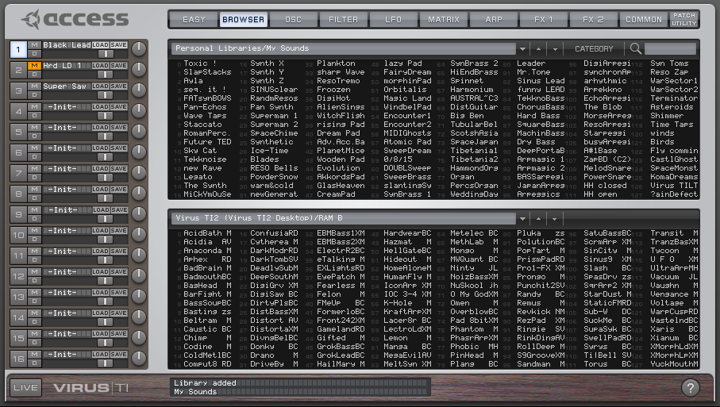

# TI Revive

*Like meeting an old best friend again.*

**Total Integration for the Access Virus TI on Windows 11, macOS and Linux — without the old drivers.**

Website with downloads, features and help: **[derpsn.github.io/access-virus-ti-revive](https://derpsn.github.io/access-virus-ti-revive/)**

> **Important - Windows: update with your Access .msi at hand (0.8.33).** Setups of TI Revive 0.8.32 and older could
> copy the 32-bit `Virus Control.dll` from your Access installer instead of the 64-bit one; with it, old Virus A, B and
> C patch libraries loaded empty. Since 0.8.33 TI Revive reads only the 64-bit file, and with the 32-bit one the
> plug-in shows no editor. When you update, put the Access "Virus TI Software Suite" 64-bit `.msi` next to the setup
> (or in Downloads) and keep "Set up the Access Virus TI files now" checked on the last page: the setup replaces the
> file. Already updated without it: *Start, TI Revive, Set up Access Virus TI files*. Linux: run `./install.sh` again
> with the `.msi`. The TI Revive Control Center says when it finds the 32-bit file. macOS is not affected.

> ☕ **Free, and it will stay free.** Every change is tested on the real synth on Windows, macOS and Linux, often
> back and forth between the three, and that takes a lot of evenings. If TI Revive gives your Virus a second life and
> you'd like to say thanks, you can [buy me a coffee](https://buymeacoffee.com/callmederpsn). It is entirely
> optional; every feature works the same either way. A test report or a kind word helps just as much.

<p align="center">
  <br>
  <em>"TI Revive Virus Control" in the DAW: the original layout, drawn natively</em>
</p>
<p align="center">
  <br>
  <em>TI Revive Control Center: device, backups, Nerd mode</em>
</p>
<p align="center"><sub>Both take their look from your own Access installer at runtime; the screenshots show it,
the software itself contains no Access material.</sub></p>

TI Revive brings the Access Virus TI (Desktop, Polar, Keyboard) back to current computers. Since 0.8.0 it comes
with **"TI Revive Virus Control"**: a plug-in written from scratch that looks and works like the original Virus
Control - parameter sync, preset browser, patch libraries, automation, the Virus audio in your DAW - and runs natively
on Windows, macOS (Apple Silicon and Intel) and Linux, without the old Access drivers, Rosetta, Wine or yabridge. It
reads the skin, the parameter descriptions and the ROM banks from your own Access installer at runtime; TI Revive
contains no Access material. No kernel code of its own is installed.

> **Testers wanted.** TI Revive is tested on a TI2 Desktop with Ableton Live, REAPER and GarageBand. Help us
> cover more: **Virus TI Snow** (first reports: it works with the plug-in - your test results help us make it
> official),
> **Polar and Keyboard** models, other DAWs (**Logic Pro**, Cubase, Bitwig, FL Studio, Studio One), **Intel Macs**,
> other **Linux** distributions and **Windows 10**. No coding needed: follow the
> [testing guide](.claude/skills/tirevive-test/SKILL.md) and post a
> [test report](https://github.com/derpsn/access-virus-ti-revive/issues/new?template=test_report.yml) - partial
> results help too.
>
> **With an AI coding agent** (Claude Code, Codex, Cursor, ...): this repository brings its own instructions
> ([AGENTS.md](AGENTS.md), skills for testing, diagnosing logs and preparing pull requests). Clone it, start your
> agent in the folder and paste:
>
> ```text
> Read AGENTS.md and .claude/skills/tirevive-test/SKILL.md. Help me test TI Revive with my Virus TI on this
> computer: check my setup against the README, help me install it, go through the test stages safely (no firmware
> updates, no writing stored patches, a disposable DAW project), collect the logs and draft a test report for
> me to review before posting it as a GitHub issue.
> ```

| | Windows 11 | macOS | Linux |
|---|---|---|---|
| **Download** ([Releases](https://github.com/derpsn/access-virus-ti-revive/releases)) | `TI-Revive-<version>-setup.exe` (or the same as `.msi`) | `TI-Revive-<version>-mac.zip` | `TI-Revive-<version>-linux.tar.gz` |
| **System** | Windows 11 x64 (also Windows 10) | macOS 14.4 or newer (the plug-in itself: Apple Silicon and Intel) | x86_64, Ubuntu 22.04 / Debian 12 or newer, systemd |
| **You need** | your own Access "Virus TI Software Suite" 64-bit `.msi` (only unpacked, not installed) | your own Access "Virus TI Software Suite" `.pkg` (only unpacked, not installed) | your own Access 64-bit `.msi` (only unpacked: msitools or Wine) |
| **In your DAW** | VST3 **"TI Revive Virus Control"**; ASIO device **"TI Revive Virus Audio"** (the Virus as sound card) | **"TI Revive Virus Control"** as VST3 and Audio Unit (Logic, GarageBand) | VST3 **"TI Revive Virus Control"** |
| **Tested with** | Ableton Live 11 (Windows 11 PC and VM) | Ableton Live 12 on a MacBook Air M3 (VST3), GarageBand (AU) | REAPER 7.82 on Ubuntu 26.04 |

- **Timing:** notes land sample-accurately on the grid (measured jitter 0.01 to 0.33 ms, std. dev.); the plug-in
  reports its latency so the DAW compensates it. The Virus follows the project's sample rate like with the
  original: it runs at 44.1 or 48 kHz, at other rates (88.2, 96 kHz, ...) the plug-in converts (since 0.8.32).
- **First start:** the plug-in reads RAM A-D from the Virus (a few minutes without a cache); you can play meanwhile -
  the sync pauses while notes arrive.
- **Coming from 0.7.x:** the classic plug-in "Virus TI (TI Revive)" (the original Access plug-in in a wrapper) is
  replaced. Projects saved with it open with "TI Revive Virus Control" (same plug-in ID). The Access software that
  earlier versions installed is offered for removal; the files the plug-in needs stay.
- **Virus TI Snow:** works with the native plug-in according to user reports (macOS, 0.8.3 and later:
  sound, both USB outputs, parameters; with 0.8.20 also USB 3 and the soft knobs); not tested by us - we have no
  Snow. Since 0.8.35 there is also a Snow plug-in, "TI Revive Virus Control (Snow)": like the original's own Snow
  plug-in it shows the Snow's editor with its 4 parts and uses the Snow's files from your Access installer, as VST3
  and on macOS also as Audio Unit for Logic Pro and GarageBand (the Audio Unit is new and not tested yet). A first
  user report on a Snow (VST3, macOS): parameters and sound work; like the original's Snow editor it has no level
  meter. The regular plug-in keeps working with the Snow as before, and existing projects stay on it. Please tell us in a
  [GitHub issue](https://github.com/derpsn/access-virus-ti-revive/issues) what works and what not.
  [TI Revive 0.7.4](https://github.com/derpsn/access-virus-ti-revive/releases/tag/v0.7.4) with its classic plug-in
  "Virus TI Snow (TI Revive)" stays available for Windows. If TI Revive does not find your Snow, run
  [`tirevive-usbinfo.ps1`](scripts/tirevive-usbinfo.ps1) with the Snow connected and attach the
  `TI-Revive-usbinfo.txt` it saves on your Desktop to a [GitHub issue](https://github.com/derpsn/access-virus-ti-revive/issues).
- **Virus Control Center**: Access' app does not work without its old driver. TI Revive brings its own, step by
  step: **TI Revive Control Center** (device info, backup and restore of the RAM banks, library export; also as the
  command line tool `tirevive-cc`; see "Backups" below). Firmware/OS updates and flash functions are not supported, on purpose.

> TI Revive is an independent project. It is **not affiliated with Access Music Electronics GmbH or
> Kemper GmbH**. "Access", "Virus" and "Virus TI" are trademarks of their owners and are used only to
> describe compatibility. TI Revive contains no Access software; you need your own copy of the Access
> "Virus TI Software Suite" installer. Access offers it on its [download page](https://www.virus.info/downloads);
> you need an account there to download it.

---

## Installation

### Windows 11

Requirements: Windows 11 x64 (TI Revive also runs on Windows 10, but there the original Access drivers still
work and are the simpler choice), an Access Virus TI on USB, your own **Access "Virus TI Software Suite"
64-bit installer** (`.msi`, e.g. 5.1.7), a VST3 host.

1. You do **not** need to install the Access software: TI Revive only unpacks the files its plug-in needs. If the
   Access software is already installed (TI Revive 0.7 installed it), that is fine - TI Revive offers to remove
   it and keeps those files.
2. Put `TI-Revive-<version>-setup.exe` and the Access `.msi` in the same folder (or in *Downloads*).
   The `.msi` of the same release is the identical installer without the `setup.exe` wrapper; use either one
   (if double-clicking an `.msi` does nothing on your PC, take the `setup.exe`).
3. Run it. The installer is not code-signed (a certificate costs money), so Windows SmartScreen
   may show **"Windows protected your PC"**: click **More info → Run anyway**. On the last page keep
   **"Set up the Access Virus TI files now"** checked: TI Revive unpacks your Access `.msi` (nothing of it is
   installed) and copies `Virus Control.dll`, `firmware.bin` and the manuals to `C:\Program Files\Access Music\Virus
   TI` and the factory patch libraries to *Documents\Access Music\Virus TI\Patches*. Later: *Start → TI Revive →
   Set up Access Virus TI files*. TI Revive reads only the 64-bit `Virus Control.dll`; setups of 0.8.32 and older
   could copy the 32-bit one (old Virus A/B/C patch libraries then load empty). Since 0.8.33 the plug-in shows no
   editor with the 32-bit DLL and the Control Center says why; run *Set up Access Virus TI files* again to fix it.
4. Connect the Virus TI. In your DAW, rescan plug-ins and use **"TI Revive Virus Control"** (vendor *TI Revive*).
   For the Virus as a sound card choose the ASIO device **"TI Revive Virus Audio"**.

Uninstall via *Settings → Apps → TI Revive* (removes driver package, certificate, broker, plug-in, ASIO driver and
shortcuts). Your patch libraries and the Access files stay.

### macOS

Requirements: macOS 14.4 or newer (Apple Silicon or Intel), an Access Virus TI on USB, your own **Access "Virus TI
Software Suite" installer** (`.pkg`, e.g. 5.1.7) and a VST3 or Audio Unit host. No Rosetta needed: the plug-in "TI
Revive Virus Control" runs natively as VST3 and as Audio Unit.

Unpack `TI-Revive-<version>-mac.zip`. Both parts are needed, in any order:

1. **`TI Revive.pkg`** installs TI Revive: the plug-in **"TI Revive Virus Control"** (VST3 and Audio Unit) and the USB
   service. It is not signed: right-click → *Open*, or *System Settings → Privacy & Security → Open Anyway*.
2. **`Set up Access Virus TI files.command`** unpacks **your own Access `.pkg`** (put it next to the script) and copies
   only what the plug-in reads (skin and parameter descriptions, ROM banks), the manuals and the factory patch
   libraries - the Access software itself is not installed. It parks old drivers that would block the Virus and
   offers to remove the original Access plug-ins of earlier TI Revive versions (Intel-only, no longer used).

Then connect the Virus, start your DAW and **allow it to use the microphone** when macOS asks (*System Settings →
Privacy & Security → Microphone*): macOS gives the Virus' audio only to apps with that permission. Rescan
plug-ins and use **"TI Revive Virus Control"** (VST3, or the Audio Unit in Logic / GarageBand). Projects saved with
"Virus TI (TI Revive)" of earlier versions (VST3 and Audio Unit) open with it. Your DAW may also list the original **"Virus TI"** plug-in as unusable (Intel-only):
that is expected.

Uninstall with `Uninstall TI Revive.command` (also in `/Library/Application Support/TI Revive`); it removes only
TI Revive (the Access plug-ins are removed with Access' own uninstaller).

### Linux

Requirements: an x86_64 Linux with systemd (Ubuntu 22.04 / Debian 12 or newer; tested: Ubuntu 26.04), a VST3 host
(REAPER, Bitwig, Ardour, …), your own Access 64-bit `.msi` and, to unpack it, **msitools** (`sudo apt install
msitools`) or Wine. Wine and yabridge are no longer needed for the plug-in. The Control Center window needs gtkmm 3
(Ubuntu 24.04+ `libgtkmm-3.0-1t64`, Fedora `gtkmm3.0`, Arch/CachyOS `gtkmm3`); `install.sh` names what is missing.

1. Unpack `TI-Revive-<version>-linux.tar.gz` and run `./install.sh "/path/to/Virus TI Software Suite 5.1.7.00 64-bit.msi"`.
   It allows your user to use the Virus over USB (udev rule, asks for your password once), installs the TI Revive
   broker as a systemd user socket, unpacks the Access files the plug-in needs (nothing of Access is installed),
   copies the factory patch libraries to *Access Music/Virus TI/Patches* in your documents folder (also a localized
   one such as `~/Dokumente`; an existing `~/Documents/Access Music` keeps being used) and copies
   **"TI Revive Virus Control"** to `~/.vst3`. The classic plug-in of 0.7 (Wine + yabridge) is removed;
   its projects open with the new one.
2. For stable real-time audio, let your user use real-time priority (Ubuntu: `sudo usermod -aG pipewire $USER`,
   then log out and in).
3. In your DAW, rescan plug-ins and use **"TI Revive Virus Control"**.

Any sample rate works; JACK through PipeWire (`pw-jack reaper`) works well, avoid PulseAudio as the DAW's audio
system. While TI Revive uses the Virus, it is not available as a Linux sound card; it is handed back about 30 seconds
after the plug-in is closed. Uninstall with `./uninstall.sh`. Details: `README-linux.txt` in the package.
Control Center in its plain look instead of the Access look: `install.sh` of 0.8.31 and older could miss
`Virus Control Center.exe` in the `.msi` (issue #15); run `./install.sh` with the `.msi` again, it adds the file.
TI Revive reads only the 64-bit `Virus Control.dll` (since 0.8.33); if the Control Center reports a 32-bit one, run
`./install.sh` with the `.msi` again (unpacking with Wine instead of msitools gives only the 32-bit DLL).
Known issue: after a USB cable replug, or when the Virus is switched on while no DAW runs, it can come back without
sound. Since 0.8.32 the plug-in tries to bring it back by itself (it switches the sample rate away and back, which the
Virus cannot ignore); this could not be tested against the fault yet. If it stays silent, switch it off and on once
while the DAW runs.

## Good to know

**One driver at a time.** TI Revive needs the Virus' USB interfaces for itself. Other Virus drivers on the same
computer — the old Access drivers from a full Access install, or third-party ones such as the USB driver of Aura
Plugins' Virus Editor — take the same interfaces, and TI Revive then shows "Virus TI not connected" (broker log:
`claim interface 3: LIBUSB_ERROR_ACCESS`). Disable the other driver (macOS: System Settings → General → Login Items
& Extensions → Driver Extensions, or its uninstaller) and restart. On macOS AURA's driver is the file `AURA Plugins
Virus TI USB Midi.plugin` in /Library/Audio/MIDI Drivers: move it out (for example to the desktop) and restart; put it
back to use AURA again. Since 0.8.35 the plug-in's "No Virus TI can be found" page names such a driver on macOS.

**Connected but silent?** The Virus decides per part where its sound goes (analog outputs or USB 1-3). If another
editor or driver changed that, the plug-in shows the right setting but the Virus still sends to an analog output:
in the plug-in, switch the part's output to "Out 1" and back to "USB 1" (this sends the setting to the Virus again).
On macOS also check that your DAW may use the microphone (System Settings → Privacy & Security → Microphone). On Linux, if notes and knobs work but no audio comes over USB (log: `usbaudio: alternate setting 1 failed`,
kernel log: `Not enough bandwidth`), connect the Virus directly to the computer, not through a USB hub.

**REAPER on Linux: stay in REAPER while a render runs.** REAPER 7.82 on Linux can crash right after a render from
the render dialog if another program had the focus when the render window closed, for example when you clicked into a
terminal or a browser during the render. Two short freezes in the same tests were probably the same bug (not
measured). This is a bug in REAPER's window layer, not in TI Revive: it happens with REAPER's own ReaSynth as well,
without TI Revive in the project. Until Cockos fixes it, stay in REAPER until the render window has closed.

**REAPER: a part's volume jumps to the maximum at Stop.** If your MIDI items contain volume controllers (CC 7, as many
imported MIDI files do at the start), REAPER's *Reset MIDI CC/Pitch to neutral on playback stop* sends CC 7 = 127 when
you stop, and the Virus turns it into part volume 127; Play brings the item's value back. TI Revive passes every
controller on, like the original's VST2. To keep the volume, enter `cc7=-1` under *Preferences > Audio > Playback >
CC reset overrides*, or switch the reset on stop off (the override is tested with REAPER 7.83 on Linux).

**Third USB output (USB 3).** Like the original, the Virus sends a third stereo output over USB only when you choose
it: in the plug-in, open PATCH UTILITY → Preferences and set "Input and Output Configuration" to "3 Outs / No Input".
Then a part's output can be "USB3 L+R" (greyed out before), and its sound comes out of the plug-in's **Out 3**. The
setting is kept for this computer and sent to the Virus at every start; "2 Outs / No Input" switches it back.
"3 Outs / 1 Input" gives USB 3 as well and sends the plug-in's sidechain input into the Virus (below).

**Process audio through the Virus (sidechain input).** Like the original, the plug-in can send audio from your DAW
into the Virus: set "Input and Output Configuration" to "3 Outs / 1 Input", and on the FX 1 page set a part's Input
Mode to Static (always on) or Dynamic (played with notes) and Select to L + R. Then send an audio track to the
plug-in's sidechain input; the part's filters and effects process it. In REAPER, give the Virus track 4 channels and
send the audio to channels 3/4 (check in the pin connector that they feed Sidechain 1/2). In Ableton Live, pick the
audio track in the device's Sidechain section. In this mode the Virus does not work as a sound card for your computer.
Tested on Linux (REAPER), macOS (Ableton Live 12) and Windows 11 (Ableton Live, in a VM and on a real PC).

**Help mode.** Click the ? at the bottom right of the editor: every control gets a short note on what it does. Point
at a control to read it, click to keep the note on screen; clicks do not change values in this mode, and the page tabs
still work. Esc or ? ends it. The notes are written for TI Revive, not taken from the Access manual. A greyed-out
control says why, for example "Inactive now: Chorus Type is Off." or "depends on Input Mode, Input Atomizer."

<p align="center">
  <br>
  <sub>Help mode, drawn from your own Access installer. TI Revive is not affiliated with Access Music or Kemper.</sub>
</p>

<p align="center">
  <br>
  <sub>Help note on a greyed-out control, drawn from your own Access installer. TI Revive is not affiliated with Access Music or Kemper.</sub>
</p>

**Libraries by drag and drop.** Drag a library's .mid or .syx file from Explorer, Finder or your file manager onto one of the two browser panes (since 0.8.35, our own addition: the original takes no file drops). While you drag, the LCD says "Drop to add a library". The file is copied into Personal Libraries (Access Music/Virus TI/Patches in your Documents folder), never over an existing file, and the pane you dropped it on shows it at once; a .syx is saved as a .mid so the original finds it too. Dropping the same library again only shows it. Tested on Linux (REAPER); not tested on Windows and macOS yet.

<p align="center">
  <br>
  <sub>A library dropped onto the upper browser pane (Linux), drawn from your own Access installer. TI Revive is not affiliated with Access Music or Kemper.</sub>
</p>

**Projects bring back every patch setting** (0.8.18). Older versions saved the parts in a format the Virus converts
itself, and it reset about 20 newer settings on loading: Input Mode, unison, arpeggiator mode, chorus type, envelopes
3 and 4 and more. Projects now keep the current format; older projects are converted when they open, and settings
that never reached the Virus open as the Virus played them. A new project's chorus shows "Classic": that is what the
Virus makes of the original's Init patch.

**When the Virus is missing**, switched off or unplugged, the editor shows the original's "No Virus TI can be found"
page and the page tabs are locked, as in the original. The page goes away by itself when the Virus is back. Do not
follow its advice to hold ARP EDIT while switching the Virus on; TI Revive does not need that.

**Export and freeze without a workaround.** The original refused offline rendering, so you had to find your DAW's
real-time render setting or record the Virus live. TI Revive supports it: when your DAW renders offline (export,
freeze, offline bounce), the plug-in holds each block until the Virus has made its sound. The render is right, but not
faster than the song: the Virus plays in real time. Right after a project opens, the render first waits a few seconds
for the Virus.

**"A sync error occurred. Press Stop and Play to clear."** Like the original, the editor shows this when the Virus
reports several notes in a row that arrived too late for their time stamp while your DAW plays. Stop and Play clears
it. If it comes back, use a USB port the Virus does not share with other devices; the original gives the same advice. On macOS, notes could come late after an export in 0.8.25 and 0.8.26; since 0.8.27 the plug-in fills the audio cycles Core Audio skips during an export. In 0.8.30 a few notes of an export at a small buffer size (128 samples) still came 3-6 ms late and the message appeared; fixed in 0.8.31 (an export at 48 kHz and 128 samples: 256 of 256 notes on the grid).

**Start playback slightly before the first note.** The plug-in sends notes to the Virus ahead of time to make up
for the USB round trip; right at Play, notes in the first quarter second can come late or be skipped. This was the
same with Access' own driver.

**All systems**

- **Editor size:** right-click on an empty spot of the editor (or of the Control Center's Access look; there also
  *View > Size*) and choose 100 % to 200 %; the plug-in also follows Windows' display scaling. The original images
  are made for 100 %: at larger sizes and on high-resolution screens (Retina) the plug-in enlarges each image once
  with a sharp filter, in memory only, so they stay crisp (the first visit of a page takes a moment longer). The
  Control Center's Access look still stretches them.
- **REMOTE page** (since 0.8.22): the Virus' remote templates with their names, knob names and MIDI strings, the
  original's knob template list, template files to load and save, sent to the Virus like the original.
- **Menus, reworked:** since 0.8.22 the plug-in's menus are reworked and modernized, and they work the same on
  Windows, macOS and Linux. Every menu (value lists, LOAD and SAVE, banks, libraries) is a window of its own, like the
  original's menus on Windows: it can reach beyond the plug-in window and use the whole screen, with the original's
  columns (the Wavetable list: 4 columns of 25). A submenu opens when the pointer rests on its entry for a moment, so
  you can move across other entries into an open submenu, for example from RAM A to its patches past RAM B. Arrow
  keys, Return and Esc work; a click elsewhere or switching to another window closes the menu. Since 0.8.25 they also
  look like the original's on Windows 10: menus with one column in Windows' modern look, menus with columns in the
  older one. Since 0.8.26 they open on the monitor they belong to on Linux, also with several monitors of different sizes.
- **Projects made with the original plug-in:** projects with its VST3 version open with "TI Revive Virus Control"
  (since 0.8.25: the plug-in list also shows it as "TI Revive Virus Control (original projects)", which has the
  original's plug-in ID; tested in Ableton Live 11 and 12, also a Windows project on the Mac); the saved state is byte
  for byte the same. Projects with the original's VST2 version do not open: TI Revive is VST3 only.
- **LOAD menu:** the original's "Revert to" (back to the patch before the last load, edits included) and "Recently
  Used" (the last 10 patches of each part); "Create Empty Library" is in the SAVE menu's Personal Libraries, as in the
  original (since 0.8.25; until 0.8.28 also in LOAD and the browser). Since 0.8.35 the LOAD menu also has "Init
  Patch" (our own addition): the init patch from your Access installer, to start a sound from scratch; "Revert to"
  brings the previous sound back.
- **Browser drag and drop like the original** (since 0.8.29): drag one or several patches (Shift = range, Ctrl = single
  entries) from a library onto a RAM slot in the other pane, or drag a part's patch name onto a RAM slot; within one
  RAM bank a drag swaps the patches; Alt+click renames a RAM patch; right-click "Undo last operation" toggles the
  last change. Program +/- on the Virus then reaches those patches (it only steps through the Virus' own banks, in the
  original too). Personal libraries work the same way (copy into them, swap, rename, "Delete selection", "Sort
  alphabetically"), and patches keep their positions with gaps like in the original. A RAM bank's right-click menu
  has "Download entire bank from Virus TI" (reads all 128 again, about 2 minutes, progress on the LCD) and "Sort alphabetically" (writes
  only the slots that change; like the original, it cannot be undone).
- **Library folders like the original's** (since 0.8.29): Patch libraries from the original's three places, each its own menu (since 0.8.29): Personal Libraries (your Documents folder), User Libraries and Public Libraries. On the Mac the factory libraries that Access installs in /Library/Application Support appear under Public Libraries. On Linux only Personal Libraries. To add a library, drop its .mid or .syx file from Explorer, Finder or your file manager onto the browser (since 0.8.35, our own addition: the original takes no file drops). It is copied into Access Music/Virus TI/Patches in your Documents folder, never over an existing file, and the browser shows it at once; a .syx is saved as a .mid so the original finds it too. Copying the file into that folder yourself works as well; it shows up the next time the plug-in is loaded. Damaged patches in a library (dumps of the wrong length) are left out, as in the original; since 0.8.35 the plug-in's log names the library and how many.
- **The LCD shows the control under the mouse** (since 0.8.34), as in the original: its name, its value, the value stored in the patch in brackets, and the part.
- **Presets, soft knobs and the part selected on the Virus itself** are followed, as in the original (the part since
  0.8.33).
- **Three stereo outputs over USB, plus the analog outputs of the Virus.** Parts on the analog outputs stay in time
  with the USB parts: like the original, the Virus holds them back by the USB latency (since 0.8.33).
- **Knobs on the Virus reach your DAW:** knobs you turn on the Virus reach your DAW like the plug-in's own knobs while the plug-in window is open (since 0.8.29, [issue #10](https://github.com/derpsn/access-virus-ti-revive/issues/10)): Ableton Live's Configure mode adds them and automation records them. Tested in Ableton Live 11 (Windows 11, VM), Ableton Live 12 (macOS) and REAPER (Linux).

<p align="center">
  <br>
  <sub>The LOAD menu reaching beyond the plug-in window (Linux), drawn from your own Access installer. TI Revive is not affiliated with Access Music or Kemper.</sub>
</p>

- **Export, freeze and offline bounce** work without a real-time render setting or a live recording: the plug-in
  renders at the pace of the Virus. The original refused offline renders.
- **The original's sync error message**, shown when the Virus reports late notes while your DAW plays.
- **The original's start-up page**: "Starting up" with its filling ring while a project opens; "Syncing memory with
  Virus" only when the plug-in really reads banks from the Virus (since 0.8.27).
- **One plug-in instance per synth.** Virus Control is designed that way (it controls all 16 parts);
  a second instance shows "Virus in use by another instance" and takes over when the first one is removed.
- **Hearing the Virus**: with a part output set to *USB*, the audio comes through the plug-in track.
- **Bank sync** takes about one second per preset — the synth itself sends dumps at that speed. It runs once (then
  only changed presets are fetched), and you can play while it runs.
- **Logs for bug reports:** create an empty file `diag.on` in the plug-in's folder (Windows
  `%LOCALAPPDATA%\virus-ti-native`, macOS `~/Library/Application Support/virus-ti-native`, Linux
  `~/.local/share/virus-ti-native`), reproduce the problem and attach `diag.log` from there (see CONTRIBUTING.md).
- Do not run firmware/OS updates of the Virus through TI Revive; that path is not verified.

**Backups: TI Revive Control Center**

Start **TI Revive Control Center** (Windows: Start menu, folder "TI Revive"; macOS: Applications; Linux: the
application menu, or `tirevive-control-center`). It looks like Access' Virus Control Center when that is in your
Access installer (the setup step copies its images; it loads the look from there, like the plug-in). Click the Virus
picture to choose your model (Desktop, Keyboard, Polar): USB does not tell them apart. It works next to your DAW: the
plug-in and the Control Center share the Virus (only plug-ins of two programs do not, see below). The window shows the connected Virus and its RAM banks, backs them up as patch libraries, restores a bank from
such a backup and converts libraries between `.mid` and `.syx`. **Nerd mode** (button or *View > Nerd mode*) shows live what goes between
TI Revive and the Virus (decoded: notes, parameter changes by name, dumps, bank sync), which programs use the Virus,
the plug-in's and the broker's logs; it switches the plug-in log on and off and saves all logs for a bug report in
one file. It only watches: it never sends anything to the Virus. Its *Options...* menu switches a few things for
comparisons with the original: the output delays only on change instead of at every Play/Stop, and the timing as
before 0.8.35 (from the next start of the plug-in).

**Restore** (since 0.8.30): *Restore...* (in the Access look: RESTORE) asks for a backup's `RAM B.mid` (or any library), then for the RAM bank to overwrite. Only the programs that differ are written, into the Virus' RAM, the way the plug-in's browser writes them, and each one is read back. Unlike Access' Control Center it never writes the Virus' flash. The same from a terminal: `tirevive-cc restore B "RAM B.mid"`.


The same from a terminal:

```
tirevive-cc info      # the connected Virus and its RAM banks
tirevive-cc backup    # RAM A..D as patch libraries (.mid) in Documents/Access Music/Virus TI/Backups/<date time>
tirevive-cc restore B "RAM B.mid"     # RAM B from a backup or library: only the programs that differ (asks first)
tirevive-cc list FILE.mid             # the patch names in a library
tirevive-cc export FILE.mid OUT.syx   # convert a library (.mid <-> .syx)
tirevive-cc logs      # plug-in + broker logs in one file for a bug report (home folder and user name removed)
tirevive-cc debug on  # the plug-in's log (from the next start of the plug-in)
tirevive-cc option    # the Options of Nerd mode; tirevive-cc option outdelay-changes on|off
tirevive-cc watch     # Nerd mode in the terminal: the traffic, decoded, while the plug-in plays
```

Where it is: Windows `C:\Program Files\TI Revive\tirevive-cc.exe`, macOS
`"/Library/Application Support/TI Revive/tirevive-cc"`, Linux `~/.local/bin/tirevive-cc`. A backup takes a few
seconds when the plug-in's bank sync is current, otherwise about 2 minutes per bank. To open a backup in the plug-in,
copy its `.mid` files into the `Patches` folder. Only `tirevive-cc restore` writes to the Virus, and only into its
RAM (since 0.8.30). Firmware/OS updates, "Burn To Flash" and factory reset are not supported, on purpose: they write
the Virus' flash and can brick it. Details: [native/docs/controlcenter.md](native/docs/controlcenter.md).

**Windows**

- REAPER loads and connects the plug-in; make sure the track is record-armed with a MIDI input and monitoring on.
- **Virus as sound card**: choose the ASIO device **"TI Revive Virus Audio"** to play your DAW through the Virus
  outputs and record its inputs (analog in, USB 1, USB 2); buffer 256 samples. No Access driver is needed.
- **No Windows (WDM) sound card**: the Virus audio function runs on WinUSB and is streamed by TI Revive itself
  (as with the old Access driver), so "Line (Virus TI)" / "Speakers (Virus TI)" no longer appear in Windows;
  use the ASIO device in your DAW. When you update from TI Revive 0.2.x, the audio part of the Virus switches to
  WinUSB automatically; if the Virus audio does not work afterwards, unplug and replug the Virus once.
- **Windows MIDI ports** ("Virus TI MIDI"/"Virus TI Synth") of the old driver are not provided.

**macOS**

- **Microphone permission** for your DAW is required (see above); without it the plug-in stays silent.
- **One DAW at a time** uses the Virus (as with the Access driver): the plug-in in a second DAW or GarageBand next
  to it shows "Virus unavailable" until the first one is closed. The Control Center works next to the DAW. If the Virus ever stays silent although the plug-in is
  connected, switch the Virus off and on once.
- **VST3 and Audio Unit**: VST3 hosts (Ableton Live, Cubase, Bitwig, REAPER, ...) and Logic Pro / GarageBand (*AU
  Instruments → TI Revive → TI Revive Virus Control*; in GarageBand under *Smart Controls → Plug-ins*) use the same
  native plug-in. Tested: Ableton Live 12 (VST3), GarageBand (AU); other hosts should work — reports welcome. Each
  DAW needs its own microphone permission.
- Access' **Virus Control Center** (32-bit) does not run on current macOS; for backups use `tirevive-cc` (above).
- The Virus' audio comes from macOS' own USB audio driver (the "Virus TI" audio device, 44.1 or 48 kHz like the project); unplugging and
  replugging the Virus is detected by the plug-in.
- Logs for bug reports: the plug-in's `diag.log` (see above) and `/tmp/tirevive-vtibroker.log`.

## Problems in the original Access plug-in

Did the original Access plug-in, **Virus Control**, the one that came with the Virus TI, have problems for you? TI
Revive rebuilds that plug-in, and we want to fix its problems instead of copying them.

**Already fixed**

- In our timing test the original plug-in played the first note late and dropped the second. TI Revive puts all 256
  notes on the grid.
- While it starts up or syncs banks, the original plug-in drops the notes you play and sends "All Notes Off". TI
  Revive holds the notes back at start-up and pauses its bank sync while you play.
- Owners reported drifting notes, a delay through the plug-in and sync errors over USB
  ([Gearspace](https://gearspace.com/threads/fixing-access-virus-sync-issues.839737/),
  [Ableton forum](https://forum.ableton.com/viewtopic.php?p=938076)). TI Revive stamps every note on the Virus' own
  clock and reports its latency to the DAW: in our tests every note lands on the grid, within 0.01 to 0.33 ms
  (standard deviation).
- The original cannot export or freeze a Virus track faster than real time and shows a warning that offline rendering
  is not supported ([KVR](https://www.kvraudio.com/forum/viewtopic.php?p=1599326),
  [Zynewave forum](https://zynewave.com/topic/realtime-bounce/)). TI Revive notices an offline render and runs it at
  the pace of the Virus, so the export sounds right; it takes as long as the song.
- A reopened project could play a different patch than the one it showed
  ([Gearspace](https://gearspace.com/threads/virus-ti-patch-issue.485382/)). Since 0.8.18 TI Revive's projects bring
  back every patch setting.
- Delay compensation worked with the original only on a track insert, not on an aux bus
  ([Sagan Metro forum](https://sagantech.com/forums/viewtopic.php?p=5647)). In our test the plug-in on a track fed by
  a send (REAPER) puts every note on the grid.
- Access' software stopped working on new macOS from Sierra on
  ([Synthtopia](https://www.synthtopia.com/content/2016/09/13/access-virus-ti-owners-may-want-to-wait-to-update-their-mac-os/)),
  and Windows 11 blocks its old USB driver. TI Revive runs natively on Windows 11, macOS (Apple Silicon and Intel)
  and Linux.
- Sleep: on the Mac, sleep cut the original's connection until Access fixed it in 2008
  ([KVR](https://www.kvraudio.com/news-print.php?id=10515)). Since 0.8.24 the plug-in sets the Virus up again after
  the computer wakes, also after a short USB drop at wake (tested with a drop of under a second on Linux). In our tests
  on Windows 11, macOS and Linux the Virus played again after waking. Once, on Linux, the Virus stayed silent after waking because it kept the wrong sample rate; since 0.8.26 the plug-in keeps it quiet then, and since 0.8.32 it switches the rate away and back, which the Virus cannot ignore.

**The same as in the original**

- One plug-in instance per Virus ([Ableton forum](https://forum.ableton.com/viewtopic.php?p=823712)): it controls all
  16 parts. A second instance shows "Virus unavailable" and takes over when the first one is removed.
- The Virus follows the project's sample rate (44.1 or 48 kHz) and shows "Audio clock changed" when it switches
  (since 0.8.32).
- Owners advised a USB port directly on the computer instead of a hub
  ([Gearspace](https://gearspace.com/threads/fixing-access-virus-sync-issues.839737/)). We have not tested hubs.

**What to report**

Hanging notes, sync errors, crashes, projects that did not open, the preset browser, automation, timing. If you only
remember it roughly, say so. One we could not test: Cubase on Windows opening a project while the Virus is switched
on, where the original crashed
([Steinberg forum](https://forums.steinberg.net/t/virus-ti-plugin-crashes-cubase/159521)).
[Report a problem in the original plug-in](https://github.com/derpsn/access-virus-ti-revive/issues/new?template=original_problem.yml)
or see the [reports so far](https://github.com/derpsn/access-virus-ti-revive/issues?q=label%3Aoriginal). The
community reports and how we checked them are in [findings/claims.md](findings/claims.md) (C11-C18).

## Performance and improvements (0.8.0)

What the native plug-in "TI Revive Virus Control" does better than the classic plug-in of 0.7.x, measured on real
hardware (TI2 Desktop) - details and raw numbers in [`findings/evidence.md`](findings/evidence.md) and
[`native/docs/status.md`](native/docs/status.md).

**Timing** (16th notes at 120 BPM recorded from the Virus' USB audio, onset analysis)

| | Notes on the grid | Jitter (std. dev.) | Max. deviation | Drift |
|---|---|---|---|---|
| Classic plug-in 0.7.x (Linux, REAPER) | first note late, second missing | 0.06 ms | 1.31 ms | - |
| **0.8.27, Linux** (REAPER render, test round) | 63 / 63 | **0.16 ms** | 0.37 ms | -72 ppm |
| **0.8.31, macOS** (Ableton 12 export at 48 kHz / 128, M3, test round) | 256 / 256 | **0.01 ms** | 0.01 ms | 0 ppm |
| **0.8.23, Windows 11 PC** (Ableton Live 11 export) | 480 / 480 | **0.04 ms** | 0.71 ms | 0 ppm |
| **0.8.24, Windows 11 PC** (Ableton Live 11 export, test round) | 256 / 256 | **0.33 ms** | 2.58 ms | -1 ppm |

- The plug-in finds the Virus' own clock (a sync marker the Virus puts on USB 2), stamps every event against it and
  **reports its latency to the DAW**, so delay compensation lines recordings up with the grid (E139-E141, E143, E209).
- **Any sample rate:** the Virus follows the host at 44.1 or 48 kHz like with the original (since 0.8.32, E321-E330);
  at other host rates a 32-tap windowed-sinc resampler converts with -90 dB error (1 kHz and 10 kHz test tones at
  32/48/88.2/96 kHz), no clicks, same timing.

**CPU and real-time safety**

| | Before | After |
|---|---|---|
| Idle CPU (plug-in loaded, Virus connected) | 5 % | **1.4 %** |
| Stress test (notes on 16 channels + 32 automated parameters every block) | 19 % | **2.9 %** |
| Automation worker thread | 12.4 % | **~3 %** |
| `process()` per audio block, 3 Max for Live LFOs on Virus parameters, ~40 min | - | max 122 µs (~1 % of the block), 0 dropouts |

- The audio thread never allocates or locks; events go through fixed buffers, and note-offs always get a slot, so
  no note hangs.
- **Automation rate limit** (250 messages/s, coalesced per parameter): unthrottled parameter floods hung the Virus'
  audio until a power cycle within 4 minutes; with the limit a 4-minute full-load test (16 channels of notes + 32
  automation lanes) passes.
- Checked with ThreadSanitizer and AddressSanitizer (one race in the broker connection found and fixed); 440 unit
  tests run with every release build on Windows and Linux, plus two end-to-end tests on Linux in a virtual display
  (two editors of a duplicated track; the Control Center's window and close button).

**Editor**

| | Before | After |
|---|---|---|
| Full repaint on Linux | ~70 ms | **1-7 ms** (bitmaps kept as X pixmaps, static layer cached) |
| Knob drag step | ~5 ms | **< 1 ms** (only the changed controls are redrawn) |
| Full repaints during 4 s of automation | 56 | **4** |
| First visit of a page | 27-52 ms | **10-13 ms** (8 pages cached, bitmaps preloaded) |

**Reliability fixes found with the Virus**

- Choosing a patch for one part no longer stops the other parts for a moment. Since 0.8.27 the plug-in sends the patch like the original: in small pieces on its own USB-MIDI cable, with the other parts' notes in between. (E268-E271)
- At every Play and loop restart the plug-in sends the song position like the original (since 0.8.27), so the arpeggiator and clock-synced LFOs restart on the beat. (E275)
- A Virus switched on after the DAW no longer causes sync errors at every Play. Since 0.8.34 the plug-in also takes the Virus' sample rate when it starts the audio later; before, it kept counting 44.1 kHz while the Virus ran at 48 kHz. (E352)
- At host sample rates other than 44.1 kHz the first notes after Play and after a render no longer come late and catch up over several seconds (since 0.8.27). (E279, E280)
- The Virus releases every sounding note about a second after the last Active Sensing message it received. Since 0.8.26 the plug-in sends one every 300 ms, like the original; before, it sent one at the start only. (E237)
- The Virus keeps time-stamped MIDI in a small buffer without an overflow check. Since 0.8.26 the plug-in keeps its time-stamped MIDI well under that buffer's limit; normal playing and automation never come near it. (E238)
- When the Virus is busy for a moment, for example while you change a patch on its panel, it holds back what the computer sends. Since 0.8.26 the plug-in sends it again instead of dropping it, so a bank sync or patch dump no longer breaks. (E239)
- New projects reliably reset the Virus: it drops the message that follows a multi dump, so the plug-in now pauses
  250 ms after one (part 1 kept its old patch in 3 of 11 start-ups before, 0 of 8 after; E145).
- Notes play while the bank sync runs: the sync pauses while you play (dump requests delay the Virus' notes by
  ~130 ms) and continues in the gaps; notes are only held back for the first ~4 s, when the Virus would play them
  up to 1.6 s late (E144).
- Big knobs on Windows (images over Direct2D's 16384-pixel limit are drawn in tiles), unplug/replug recovery,
  projects use the original's state format: a state saved by the original loads (older part dumps are upgraded to
  the current format, E174).

## Why

**Windows.** The Virus TI talks to its plug-in through a custom USB kernel driver (`VirusUSB.sys`, version 2.9.66
from 2014, built on a Ploytec OEM driver). Windows 11 refuses to load it: Code Integrity blocks the
old cross-signed driver (Device Manager shows **Code 39**, event log CodeIntegrity 3076/3077). Without
that driver the plug-in reports "no Virus TI connected" and the synthesizer is reduced to a plain
MIDI module — if at all.

**macOS.** The Access kernel extension is Intel-only and can never load on an Apple Silicon Mac, and the Access
plug-ins themselves are Intel-only, so they would only run in a DAW started under Rosetta — and even there they
find no driver.

Access discontinued the Virus TI and no updated driver exists. The goal of this project was to
understand what the old drivers actually do, and to replace them with something that current systems
accept — so the synth, the plug-in and the user's existing Access software keep working. Up to 0.7.x TI Revive did
that around the original plug-in (driver emulation, Rosetta, Wine). Since 0.8.0 it has its own plug-in, rewritten
from the documented behaviour, that runs natively everywhere and only reads the skin, the parameter descriptions and
the ROM banks from the user's Access installer.

## How it works

Since 0.8.0 the plug-in is **"TI Revive Virus Control"**, a native rewrite: how it works per platform is in
[`native/docs/architecture.md`](native/docs/architecture.md). The sections below describe the classic plug-in of
TI Revive 0.7.x (the original Access plug-in in a wrapper), which 0.8.0 replaces; the broker, the USB layer and the
driver package described there are still the ones the native plug-in uses.

### Windows (WinUSB binding and broker; up to 0.7.x also the driver emulation for the original plug-in)

```
 DAW ── Virus TI (TI Revive).vst3 ── loads the user's original "Virus TI.vst3" / Virus Control.dll
          │  in-memory import hooks: SetupDi*/CreateFile/DeviceIoControl/CM_* are answered by
          │  an emulation of the old driver's interface (31 IOCTLs, shared audio memory)
          │
          ├── MIDI/remote: named pipe \\.\pipe\vtibroker
          │      vtibroker.exe (per-user background process, started on demand, exits when idle): owns the MIDI interfaces,
          │      keeps them drained, re-connects after unplug, serves plug-in + Control Center
          │        ▼  WinUSB (Microsoft, inbox)  ──  Virus TI MI_03 + MI_04
          │
          └── audio: isochronous streams, directly from the plug-in process
                   ▼  WinUSB (Microsoft, inbox)  ──  Virus TI audio function MI_00 (interfaces 0..2)
```

**Driver binding.** An INF-only driver package assigns Windows' built-in **WinUSB** driver to the
Virus TI's two vendor-specific (MIDI/remote) interfaces and to its audio function. Because the package contains no
binaries, it only needs a signed catalog: the installer creates a certificate on your computer, signs
the catalog, trusts the certificate's public part and **deletes its private key** right away, so it
cannot sign anything else. Uninstall removes package and certificate again.

**Plug-in and Control Center.** The Access software stays unmodified on disk. TI Revive's VST3 wrapper
loads the original plug-in and patches its import table in memory; Virus Control Center is started
through a small launcher that does the same. Every call the Access code makes to the old driver is
answered by a user-mode emulation (`src/wrapper/vtiemu.c`):

- the raw USB-MIDI channel (the plug-in writes 4-byte USB-MIDI packets; received data goes into a
  ring buffer shared with the plug-in and an event is signalled — exactly like the old driver did),
- vendor control requests (flash/version reads; translated so WinUSB passes them unchanged),
- start-up queries (version strings, configuration blocks) replayed from the original driver,
- the device topology that Control Center inspects (`CM_Get_Parent` / `CM_Get_Device_IDA`).

**Audio through the plug-in.** The old driver mapped a shared ring buffer ("AudioSM") into the
plug-in's process and filled it with the Virus' six USB audio channels. TI Revive allocates that buffer
itself; the broker streams the Virus' isochronous audio endpoints directly on WinUSB, the way the old driver did,
and shares the samples with the plug-in (and the ASIO driver) through shared memory:
44.1 kHz, every received packet's frame count is mirrored on the stream towards the synth, so the synth's
clock is the master and the plug-in's sample counter is exactly the number of frames the synth produced
(its MIDI timestamps then never drift against the synth). Reads are scheduled on USB frame numbers, so
even a stalled PC keeps the counter exact (the gap is filled with silence). The samples go into the
buffer in the driver's format and the plug-in's audio thread is clocked with the same buffer-switch event.
If the audio function is not on WinUSB, TI Revive falls back to the Windows "Virus TI" recording device
(WASAPI, exclusive 44.1 kHz).

**ASIO sound card.** Like the Access ASIO driver, TI Revive offers the Virus as an ASIO device,
**"Virus TI (TI Revive)"**: a small COM wrapper (`TIRevive_ASIO.dll`) loads your original Access ASIO driver
(`VirusUSB_X64.dll`) and answers its driver calls with the same emulation as the plug-in. Its 2 inputs are the
Virus analog inputs, its 2 outputs play through the Virus outputs, 44.1 kHz, 256 samples - exactly the
original's channels and buffer. Plug-in and ASIO driver run at the same time and follow the same synth clock.

**The broker.** WinUSB allows one owner per interface, and the Virus stops accepting data when nobody
reads its input endpoints. `vtibroker.exe` therefore owns the device while it is in use, sends the
initialisation handshake, keeps both IN endpoints drained, re-opens the device after unplug or
errors, and multiplexes it for the plug-in and Control Center. It is not started at logon: the plug-in or
Control Center starts it when they need the Virus, and it exits 30 seconds after the last of them has gone.

### macOS (0.7.x: the bridge hosting the original under Rosetta; since 0.8.0 only the broker is still used)

```
 DAW (native, arm64) ── Virus TI (TI Revive).vst3 (native bridge)
          │  audio + MIDI per block through shared memory, control/state/parameters over a socket,
          │  the editor shown as a live picture with mouse/keyboard forwarded (menus appear natively in the DAW)
          ▼
 vtihelper (x86_64, under Rosetta 2) ── hosts the user's original "Virus TI.vst3" / Virus Control.bundle
          │  Virus Control links Access' driver library libVirusUSB.dylib - TI Revive installs its own in its place:
          ├── audio: an IOProc on macOS' own "Virus TI" USB audio device (Core Audio, 6 in / 2 out, 44.1 kHz)
          └── USB control requests, device presence, MIDI ──▶ vtibroker (native, started on demand)
                                                                 ▼  libusb  ──  Virus TI vendor interfaces 3 + 4
```

**No Access drivers.** On the Mac, Virus Control does not talk to the kernel extension itself but to Access'
user-space driver library `libVirusUSB.dylib` (20 methods of a C++ class `VirusClient`) and, for MIDI, to Access'
Core MIDI driver through shared memory and a message port. TI Revive replaces both: its own `libVirusUSB.dylib`
answers the plug-in's calls, and the broker stands in for the MIDI driver (same shared-memory layout and ring
buffers). The Virus' audio function is class compliant, so macOS' built-in driver provides it; TI Revive feeds it
to the plug-in in the format Access' driver used.

**Native DAW, Intel plug-in.** The Access plug-ins are Intel-only, so a native DAW cannot load them. TI Revive's
native bridge plug-in starts a helper under Rosetta 2 that hosts the original, passes audio, MIDI, parameters,
automation and the saved state through, and mirrors the original editor into the DAW window — including its popup
menus and text fields. The helper is started by the DAW, so the DAW's microphone permission covers it.

The full protocol description is in [`findings/spec.md`](findings/spec.md); every statement there is
backed by an entry in [`findings/evidence.md`](findings/evidence.md) (captures, traces, decompiled
driver code). The macOS design is in [`findings/design-macos.md`](findings/design-macos.md) and
[`findings/design-macos-bridge.md`](findings/design-macos-bridge.md).

### Linux (0.7.x: the classic plug-in under Wine + yabridge)

```
 Linux DAW (native) ── yabridge ── Wine: "Virus TI (TI Revive).vst3" (the Windows wrapper) ── your original Virus TI.vst3
                                          │  the same driver emulation as on Windows; device access over a
                                          │  token-protected local socket, audio ring in /dev/shm
                                          ▼
                              vtibroker (native, libusb, started by systemd on demand): the whole Virus TI -
                              MIDI on interfaces 3/4 and the USB audio, streamed isochronously like on Windows
```

Linux' own USB audio driver cannot share the Virus (taking the vendor interfaces away shuts its sound card down),
so the broker owns the whole device while TI Revive is in use and hands it back to Linux afterwards. Design and
measurements: [`findings/design-linux.md`](findings/design-linux.md), evidence E113–E121.

## Status

| Milestone | |
|---|---|
| Reverse engineering of driver, protocol and plug-in interface | done (`findings/`) |
| **0.8.0: native plug-in "TI Revive Virus Control" (all platforms)** | |
| Plug-in (editor, browser, libraries, bank sync, automation, project state), opens projects of the classic plug-in | done: tested in REAPER (Linux), Ableton Live 12 (macOS M3), Ableton Live 11 (Windows 11 PC) |
| The Virus follows the host's sample rate (44.1 / 48 kHz) like the original | done: tested on Linux, Windows 11 (VM) and macOS (E326-E330, E335) |
| Timing: sample-accurate, latency reported to the DAW, any sample rate | done: 0.01-0.33 ms jitter, drift -72 to 0 ppm (E139-E143, E209, E216, E278, E289, E308, E319) |
| ASIO sound card "TI Revive Virus Audio" (Windows, 6 in / 2 out, no Access driver) | done: clean on a real PC |
| Installers: Access software only unpacked (Windows/Linux), clean-up of earlier versions | done |
| Virus TI Snow | works per user reports (macOS, 0.8.3+; USB 3 and soft knobs with 0.8.20); not tested by us |
| Audio Unit (AUv2) of the native plug-in, with the classic Audio Unit's codes (its Logic / GarageBand projects open) | done: passes `auval`, tested in GarageBand |
| Control Center app + command line `tirevive-cc` (device info, backup, restore into RAM, library export) | done: CLI tested on macOS (M3), app on Linux, both with a TI2 |
| Control Center: restore into RAM | done in 0.8.30: RAM only, tested with a TI2 on Linux, Windows 11 (VM) and macOS (E313, E314); flash functions and OS update: never |
| Windows MIDI ports | open |
| **Windows** | |
| WinUSB driver package, broker with USB audio, unplug recovery, Windows 11 with memory integrity (HVCI) | done |
| MSI + setup.exe (GitHub Actions build) | done |
| 0.2-0.7.x: user-mode driver emulation for the original plug-in, ASIO wrapper, Control Center | done, replaced by 0.8.0 |
| **macOS** | |
| USB broker (no Access kernel extension); the MIDI driver stand-in of the classic path is opt-in since 0.8.2 (`VTI_BROKER_MIDISHIM=1`) | done |
| Installer (.pkg + Access file setup, GitHub Actions build) | done |
| 0.5-0.7.x: bridge (VST3 + AU) with a Rosetta helper hosting the original, own libVirusUSB | done, replaced by 0.8.x |
| **Linux** | |
| Broker with USB audio on libusb, device handed back to Linux | done |
| Installer (`install.sh`, systemd user socket, udev rule, GitHub Actions build) | done |
| 0.7.x: the Windows wrapper under Wine/yabridge | done, replaced by 0.8.0 |

## Building

**Plug-in "TI Revive Virus Control" (all platforms).** CMake 3.25+, with the VST3 SDK as a submodule:

```sh
git submodule update --init --recursive native/external/vst3sdk
cmake -S native -B build-native -DCMAKE_BUILD_TYPE=Release && cmake --build build-native && ctest --test-dir build-native
```

Windows needs MSVC (Visual Studio 2022; also builds the ASIO driver), macOS Xcode (universal:
`-DCMAKE_OSX_ARCHITECTURES="arm64;x86_64"`), Linux the X11/cairo development packages listed in the release
workflow (job `native-linux`). Details: [`native/README.md`](native/README.md).

**Broker and Windows tools.** Cross-compiled on Linux with mingw-w64 (the Linux broker with gcc and libusb):

```sh
make -C src/broker      # vtibroker.exe + test tools (vtiprobe, vtisend, vtiflash), Linux broker / libusb probe
make -C src/wrapper     # the classic 0.7.x Windows plug-in (not shipped since 0.8.0)
make -C src/vtihook     # research tools: IOCTL tracer, injector
```

The MSI is built with WiX 5 on Windows (`src/installer/build.ps1 -NativeBin <folder>`); `scripts/win11/build-msi.sh`
does the same round trip through a local Windows 11 build VM.

**macOS package.** On a Mac with the Xcode Command Line Tools and the (MIT-licensed) VST3 `pluginterfaces` next to the
repository: `scripts/mac-build-release.sh <repo> <version>` builds `TI-Revive-<version>-mac.zip` (native plug-in,
broker with libusb built from source, .pkg, scripts).

**Releases.** GitHub Actions (`.github/workflows/build.yml`) builds everything, but only when a version tag `vX.Y.Z`
is pushed (`git tag -a v0.8.0 -m ... && git push origin v0.8.0`): it then publishes a **Release** with
`TI-Revive-X.Y.Z-setup.exe`, `TI-Revive-X.Y.Z.msi`, `TI-Revive-X.Y.Z-mac.zip` and `TI-Revive-X.Y.Z-linux.tar.gz`.
Branch pushes and pull requests do not build.

## Repository layout

| Path | Content |
|---|---|
| `native/` | the native plug-in "TI Revive Virus Control" (VST3, all platforms) and the ASIO driver "TI Revive Virus Audio": `native/README.md`, `native/docs/architecture.md` |
| `findings/` | the research: `spec.md` (protocol), `evidence.md` (every observation with its source), `claims.md` (community claims checked), `design*.md`, `HANDOFF.md` (working log) |
| `src/broker/` | device access (WinUSB / libusb / named-pipe backends), broker (Windows and macOS; the macOS MIDI driver stand-in for the classic plug-in is opt-in), hardware test tools |
| `src/wrapper/` | the classic Windows plug-in of 0.7.x (driver-interface emulation, VST3 wrapper, ASIO wrapper, Control Center launcher); not shipped since 0.8.0 |
| `src/inf/` | Windows: the WinUSB driver package |
| `src/installer/` | Windows: MSI (WiX), driver script, `tirevive-access.ps1` (unpacks the Access files) |
| `src/mac/` | macOS, the classic 0.5-0.7.x path (not shipped since 0.8.x, kept for reference): `libvirususb/` (replacement libVirusUSB.dylib), `bridge/` (VST3/AU bridge), `helper/` (Rosetta host), `common/` (bridge protocol), diagnostics tools |
| `src/installer-mac/` | macOS: package scripts, Access installer script, uninstaller, README-mac |
| `src/vtihook/` | research tools: IOCTL tracer with AudioSM monitor, process memory readers |
| `scripts/` | capture/decode tools (usbmon + tshark), Windows 11 VM tooling, Mac build and lab scripts |

## How this was built

The work started from community notes about the Virus TI's USB protocol and a Windows 10 VM with USB
passthrough. Each claim was verified against evidence: USB captures of the original driver (usbmon),
the installer and driver binaries (static analysis with Ghidra), runtime traces of the plug-in's driver
calls (an import-table hook), and finally tests of each replacement piece against the real synthesizer —
first on Linux with libusb, then on Windows 10 and Windows 11 VMs, and on a MacBook Air M3 driven over SSH for
the macOS version. For 0.8.0 the plug-in itself was rewritten (`native/`): its UI is drawn from the original's layout
and skin files at runtime, every protocol detail was measured on the synth (timing with recorded test patterns,
read-backs of the Virus' memory), and parts that were first ported from the analysis were rewritten from documented
behaviour with golden tests. `findings/evidence.md` lists 145 numbered observations, including the wrong turns and
their corrections.

The reverse engineering and the code were done by derpsn together with Claude (Anthropic) as an
AI pair programmer.

## Contributing

Bug reports, tests on your setup and pull requests are welcome — see [CONTRIBUTING.md](CONTRIBUTING.md). If you work
with an AI coding assistant, it finds its instructions in [AGENTS.md](AGENTS.md) (Claude Code also reads
`CLAUDE.md` and the skills in `.claude/skills/`).

## Using our findings

The protocol knowledge in [findings/](findings/) is free to use. If it helps your project, we would be happy about a
mention, for example: "Protocol knowledge from TI Revive (https://github.com/derpsn/access-virus-ti-revive)".
Corrections and new observations are welcome as issues, so everyone benefits. GitHub's "Cite this repository" button
gives the same as a citation.

## License

[MIT](LICENSE) © 2026 derpsn. Provided as is, without warranty — on Windows this installs a driver
package and a certificate on your computer; use at your own risk. The programs contain third-party code under its
own licenses (VST3 SDK, VSTGUI, pugixml, AudioUnitSDK, libusb, winpthreads): see
[THIRD-PARTY-NOTICES.txt](THIRD-PARTY-NOTICES.txt), which every package includes. The screenshots in `docs/images/`
and `site/` show the Access look of the plug-in and are not covered by the MIT license.
